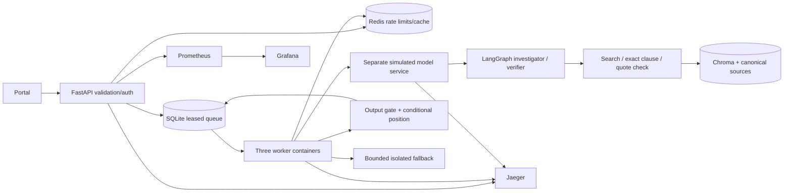

# Academic Regulation and Student Petition Triage Service

Mini Project 15 · ML System Design & AgentOps · UE24AM342AA5.

An asynchronous, source-grounded petition desk using the IISc Undergraduate Handbook 2025–26. It produces conditional recommendations and complete clause citations for human review. It never makes the final academic decision. Use fictional petitions only.

## Run

Start Docker Desktop in Linux-container mode, then from the cloned project:

```powershell
.\scripts\start.ps1
```

Open http://127.0.0.1:8000 and enter the local workspace key from `.secrets/triage_key`. First startup downloads dependencies and public embedding weights, then initializes the corpus. No hosted API key or payment is required for the default simulated workflow. Each teammate generates their own keys; never share `.env`, `.secrets` or runtime records in Git.

The starter generates secrets in a disposable container if the existing project virtual environment is absent. All application services run in containers. See [deployment instructions](docs/operations.md) for clean-clone setup, monitoring, tests, hosted opt-in and shutdown.

## Implemented behavior

- FastAPI submission, persistent run IDs/status polling, schema/content validation, quarantine and leased background workers.
- Two separately prompted LangGraph roles: investigation selects retrieval tools; verification checks the typed handoff. Three source tools, six turns/tools per role, one bounded re-search and deterministic fallback. Simulation is clearly identified.
- Conditional attendance processing/restriction recommendations and referral where evidence or exceptions remain unresolved. Structured facts remain unverified; every position requires an officer.
- Clause-aware hybrid retrieval over Chroma: 180 pages, 496 generic chunks and 13 reviewed clause records. Full quotations, hashes, offsets, source version and verified page/section metadata. Reviewed metadata covers pilot clauses, not the whole handbook.
- Idempotent preview/apply ingestion and incremental re-embedding, manifest, freshness/count/timing reports and acknowledgment of changed source PDFs.
- Canonical source/quotation checking and complete-statement identity gate. This establishes extractive fidelity, not general semantic entailment. Finite input injection/abuse rules and output filters can miss novel attacks.
- Responsive portal with progress, recovery, source PDF links, full citations, optional fictional facts, feedback, quality sampling and run transparency.
- Workspace-key authentication, signed browser sessions, shared Redis rate limits and versioned TTL cache with output revalidation.
- Separate warmed simulated model service, bounded retries/backoff, circuit breaker, isolated deadline and durable queue recovery.
- Compose indexer/API/three workers/stub/Redis/Jaeger/Prometheus/Grafana, health checks, volumes, non-root application and loopback host ports.
- Payload-free traces, correlation logs, per-role calls/tools/retries/success/latency/tokens, metrics and provisioned Grafana dashboard.
- Versioned prompt comparison, 30 scenarios/60 local workflow runs, 22 safety cases and 22 source-meaning challenges. Locust compares worker scaling and cache against a predeclared SLO.

## Architecture



SQLite worker replication is supported on one Docker host; multi-host SQLite operation is outside this implementation. The workspace key is shared demonstration access, not individual student authorization.

## Verification status

Post-restart checks passed locally and inside Docker: 100 unit tests, 11 retrieval checks, 22 safety cases, 22 source-meaning challenges, 30 scenarios/60 local workflow runs and real HTTP/worker/restart integration.

Fresh Docker startup/index initialization, linked Jaeger spans, Prometheus scraping, the Grafana dashboard, authentication, all three conditional positions, quarantine, feedback, PDF access, real stub outage/circuit/recovery and rate limiting passed. An unchanged index run re-embedded zero of 509 records. Browser submission and saved-run recovery passed with no console errors. See the reports in `evaluations/` and [performance measurements](docs/performance.md).

| 10 clients, 60 seconds per round | Completed petitions/sec | Completion p50 | Completion p95 | Submission p95 | Failures |
|---|---:|---:|---:|---:|---:|
| 1 worker, cache off | 1.09 | 9.00 s | 9.20 s | 110 ms | 0% |
| 3 workers, cache off | 2.08 | 4.20 s | 6.30 s | 170 ms | 0% |
| 3 workers, warm cache | 15.91 | 0.44 s | 0.85 s | 560 ms | 0% |

All rounds met the predeclared completion p95 <=10 s, submission p95 <=750 ms and failure ratio <=1%. The repeated-input cache round avoided 3,760 simulated calls. No hosted requests or paid-model cost experiment was involved. These measurements describe this machine/workload, not universal production guarantees.

Hosted inference is evaluated separately. The final strict investigator v4/verifier v5 acceptance completed both real roles in four requests, with three complete canonical claims and a passing source gate. An earlier live A/B case compares the baseline and strict v3/v4 prompts; it predates the final selection protocol. Raw quota-limited attempts and compatibility failures are retained. Fallback is never counted as successful hosted inference. These small live samples cannot establish broad model quality. Provider token counts are reported when supplied; unknown billed costs remain null. Stub tokens are marked estimates and cost zero.

## Checks and shutdown

```powershell
docker compose ps
docker compose exec -T api python src/check_project.py --evaluation
docker compose run --rm indexer python src/index_corpus.py --preview
.\.venv\Scripts\python.exe scripts/verify_stack.py --observability
.\.venv\Scripts\python.exe scripts/verify_failures.py
.\.venv\Scripts\python.exe scripts/benchmark.py --seconds 60
docker compose down
```

Host drivers use the existing virtual environment; application/regression execution is containerized. Do not run failure/load drivers simultaneously. Keep volumes during shutdown to preserve fictional runs, index and model cache.

## Project guide

- [Instructor requirement map and demo](docs/requirements.md)
- [Deployment, configuration and measurements](docs/operations.md)
- [Failure runbook](docs/runbook.md) and [observed incidents](docs/incidents.md)
- [Hosted-agent design and free-plan configuration](docs/hosted_agents.md)
- [Clause-retrieval scope](docs/clause_retrieval_update.md)

Earlier stage documents and the original context handoff describe historical commits. The maintained implementation is in `src/`; `docs/proposals/` contains historical proposals.

The handbook PDF and extracted text are third-party source material. This repository grants no rights over them. Do not submit real student records or medical documents to this demonstration service.
