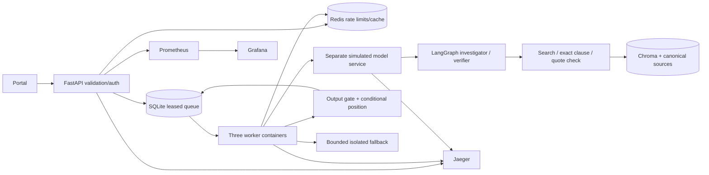

# Academic Regulation and Student Petition Triage Service

Mini Project 15 · ML System Design & AgentOps · UE24AM342AA5.

An asynchronous, source-grounded petition desk using the IISc Undergraduate Handbook 2025–26. It produces conditional recommendations and complete clause citations for human review. It never makes the final academic decision. The default demo accepts fictional petitions only; live intake uses a separate local workspace.

## Run

New teammate? Start with the [clone, Docker, Groq and project handoff guide](docs/teammate_handoff.md).

For the instructor showcase on Windows:

```powershell
powershell -ExecutionPolicy Bypass -File .\scripts\start.ps1 -Showcase
```

Open [the showcase](http://127.0.0.1:8003) and select Student, Reviewer or Administrator. All three showcase roles use `pass@1234`. The guide covers macOS/Linux, dashboard links, and the stress-test and agent-audit commands.

### Base simulation and live mode

Start Docker Desktop in Linux-container mode, then from the cloned project:

```powershell
.\scripts\start.ps1
```

Open http://127.0.0.1:8000 and enter the local workspace key from `.secrets/triage_key`. First startup downloads dependencies and public embedding weights, then initializes the corpus. No hosted API key or payment is required for the default simulated workflow. Each teammate generates their own keys; never share `.env`, `.secrets` or runtime records in Git.

The starter generates secrets in a disposable container if the existing project virtual environment is absent. All application services run in containers. See [deployment instructions](docs/operations.md) for clean-clone setup, monitoring, tests, hosted opt-in and shutdown.

For **live agents and local supporting documents**, run `.\scripts\start.ps1 -Live` and open the private workspace on port 8002. See [private workspace setup and data handling](docs/private_workspace.md). The default demo remains separate.

## Implemented behavior

- FastAPI submission, persistent run IDs/status polling, schema/content validation, quarantine and leased background workers.
- Two separately prompted LangGraph roles. The investigator selects handbook evidence. The source auditor checks quotation integrity and required-provision coverage, with one bounded re-search and recorded pass outcomes.
- Conditional attendance processing/restriction recommendations and referral where evidence or exceptions remain unresolved. Structured facts remain unverified; every position requires an officer.
- Clause-aware hybrid retrieval over Chroma: 180 pages, 496 generic chunks and 13 reviewed clause records. Full quotations, hashes, offsets, source version and verified page/section metadata. Reviewed metadata covers pilot clauses, not the whole handbook.
- Idempotent preview/apply ingestion and incremental re-embedding, manifest, freshness/count/timing reports and acknowledgment of changed source PDFs.
- Canonical source/quotation checking and complete-statement identity gate. This establishes extractive fidelity, not general semantic entailment. Finite input injection/abuse rules and output filters can miss novel attacks.
- Responsive portal with progress, recovery, source PDF links, full citations, optional fictional facts, feedback, quality sampling and run transparency.
- Authenticated printable officer handoff and versioned audit-JSON downloads for completed runs, with exact source metadata and no raw petition/queue internals. See [officer exports and conflict safeguards](docs/officer_exports.md).
- Workspace-key authentication, signed browser sessions, shared Redis rate limits and versioned TTL cache with output revalidation.
- Separate warmed simulated model service, bounded retries/backoff, circuit breaker, isolated deadline and durable queue recovery.
- Compose indexer/API/three workers/stub/Redis/Jaeger/Prometheus/Grafana, health checks, volumes, non-root application and loopback host ports.
- [Instructor showcase](docs/instructor_showcase.md) with preset role logins, an isolated workspace, and a reproducible stress test with live Grafana panels.
- Payload-free traces, correlation logs, per-role calls/tools/retries/success/latency/tokens, metrics and provisioned Grafana dashboard.
- Versioned prompt comparison, 30 scenarios/60 local workflow runs, 22 safety cases and 22 source-meaning challenges. Locust compares worker scaling and cache against a predeclared SLO.

## Architecture



SQLite worker replicas share a single Docker host. The base simulation uses a shared workspace key. The showcase and live stacks have individual role sessions and separate volumes.

## Verification status

The current Docker image passed 115 automated tests and the three supported petition workflows through the showcase API. The audit demonstration repaired an incomplete source packet. Earlier evaluation reports cover 11 retrieval checks, 22 safety cases, 22 source-meaning challenges, 30 scenarios/60 local workflow runs and HTTP/worker/restart integration.

Fresh Docker startup/index initialization, linked Jaeger spans, Prometheus scraping, the Grafana dashboard, authentication, all three conditional positions, quarantine, feedback, PDF access, real stub outage/circuit/recovery and rate limiting passed. An unchanged index run re-embedded zero of 509 records. Browser submission and saved-run recovery passed with no console errors. See the reports in `evaluations/` and [performance measurements](docs/performance.md).

| 10 clients, 60 seconds per round | Completed petitions/sec | Completion p50 | Completion p95 | Submission p95 | Failures |
|---|---:|---:|---:|---:|---:|
| 1 worker, cache off | 1.09 | 9.00 s | 9.20 s | 110 ms | 0% |
| 3 workers, cache off | 2.08 | 4.20 s | 6.30 s | 170 ms | 0% |
| 3 workers, warm cache | 15.91 | 0.44 s | 0.85 s | 560 ms | 0% |

All rounds met the predeclared completion p95 <=10 s, submission p95 <=750 ms and failure ratio <=1%. The repeated-input cache round avoided 3,760 simulated calls. No hosted requests or paid-model cost experiment was involved. These measurements describe this machine/workload, not universal production guarantees.

The recorded Groq acceptance used earlier v4/v5 prompts and completed both roles in four requests. The current v5/v6 prompts and audit retry have been verified with simulation. See [hosted verification history](docs/hosted_agents.md) for recorded outcomes and test scope.

## Checks and shutdown

```powershell
docker compose ps
docker compose exec -T api python src/check_project.py --evaluation
docker compose run --rm indexer python src/index_corpus.py --preview
.\.venv\Scripts\python.exe scripts/verify_stack.py --observability
.\.venv\Scripts\python.exe scripts/verify_failures.py
.\.venv\Scripts\python.exe scripts/benchmark.py --seconds 60
docker compose down
```

Host drivers use the existing virtual environment; application/regression execution is containerized. Do not run failure/load drivers simultaneously. Keep volumes during shutdown to preserve fictional runs, index and model cache.

## Project guide

- [Instructor requirement map and demo](docs/requirements.md)
- [Deployment, configuration and measurements](docs/operations.md)
- [Failure runbook](docs/runbook.md) and [observed incidents](docs/incidents.md)
- [Hosted-agent design and free-plan configuration](docs/hosted_agents.md)
- [Clause-retrieval scope](docs/clause_retrieval_update.md)

Earlier stage documents and the original context handoff describe historical commits. The maintained implementation is in `src/`; `docs/proposals/` contains historical proposals.

The handbook PDF and extracted text are third-party source material. This repository grants no rights over them. Keep student records out of the shared demo. Only the separate, key-protected local workspace accepts supporting documents.
